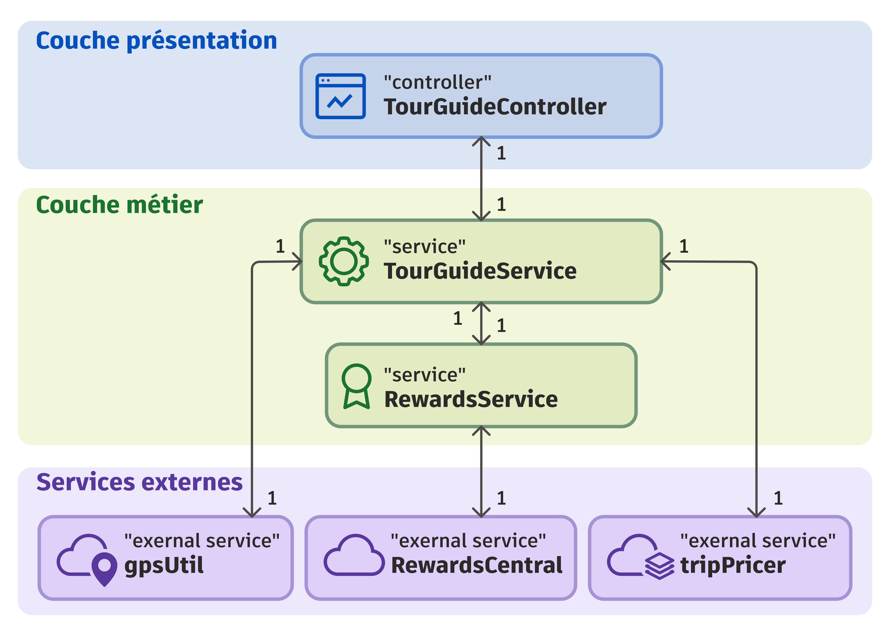

<div align="center">
  <!-- Logo -->
  

  <p>
    <strong>An application for managing tours, price calculation, and rewards system.</strong>
  </p>

  <!-- Badges (optional, remove if not needed) -->
  <p>
    
    
    
  </p>
</div>

---

## 📖 About the Project

**TourGuide** is a Spring Boot REST API designed to help users plan their trips. The application provides recommendations for nearby tourist attractions, calculates reward points for visited locations, and offers travel deals based on accumulated points.

This project is part of the **OpenClassrooms Java Developer path (Project 8)**. The main goal was to refactor and optimize a legacy application to handle a rapidly growing user base (up to 100,000 users per day), fix concurrency bugs, implement a new recommendation feature, and set up a CI/CD pipeline.

## ✨ Features

### 📍 Location & Attractions
*   Tracks user locations via an external `gpsUtil` service.
*   Returns the **5 closest tourist attractions** based on the user's last known location, regardless of distance (using a custom DTO).
*   Provides distance in miles and potential reward points for each attraction.

### 🏆 Rewards System
*   Calculates reward points for users based on their visited locations.
*   Ensures thread-safe reward calculation using `CopyOnWriteArrayList` and synchronization to avoid duplicates.

### ✈️ Trip Deals
*   Generates personalized trip deals (hotels, tickets) based on the user's accumulated reward points via `tripPricer`.

---

## 🏗 Architecture

The application follows a classic layered Spring Boot architecture, as represented in the provided UML diagram:

<!-- UML Diagram -->


### The main application layers are:
1.  **Controller** — Handles HTTP requests and exposes REST endpoints.
2.  **Services** — Contains business logic (`TourGuideService`) and reward calculation (`RewardsService`).
3.  **Models & DTOs** — Internal entities (`User`, `UserReward`) and Data Transfer Objects (`NearByAttractionDto`).

---

## ⚡ Performance & Concurrency

The initial application suffered from severe performance issues due to sequential processing and non-thread-safe collections.

**Optimizations implemented:**
1.  **Thread Safety:** Replaced `ArrayList` and `HashMap` with `CopyOnWriteArrayList` and `ConcurrentHashMap` to fix `ConcurrentModificationException` (flaky tests).
2.  **Parallel Processing:** Used `CompletableFuture` and a fixed `ExecutorService` thread pool (200 threads) to parallelize calls to slow external services (`gpsUtil` and `RewardsCentral`).
    *   *Why 200 threads?* External services use `Thread.sleep()` to simulate network latency. Threads do not consume CPU while waiting. A large pool masks this latency without overloading the processor.
3.  **Performance Results:** Processing time for 100,000 users was reduced from **several hours** to just **~10,1 minutes** for location tracking and **~7.3 minutes** for reward calculation, comfortably meeting the business requirements.

---

## 🚀 Installation

### Requirements

*   Java 21
*   Maven

### 1. Install local dependencies

Because `gpsUtil`, `RewardCentral`, and `TripPricer` are local JAR files (located in the `/libs` folder), they must be installed into your local Maven repository before building the project. Run these commands in the project root:

    ```bash
    mvn install:install-file -Dfile=libs/gpsUtil.jar -DgroupId=gpsUtil -DartifactId=gpsUtil -Dversion=1.0.0 -Dpackaging=jar
    mvn install:install-file -Dfile=libs/RewardCentral.jar -DgroupId=rewardCentral -DartifactId=rewardCentral -Dversion=1.0.0 -Dpackaging=jar
    mvn install:install-file -Dfile=libs/TripPricer.jar -DgroupId=tripPricer -DartifactId=tripPricer -Dversion=1.0.0 -Dpackaging=jar